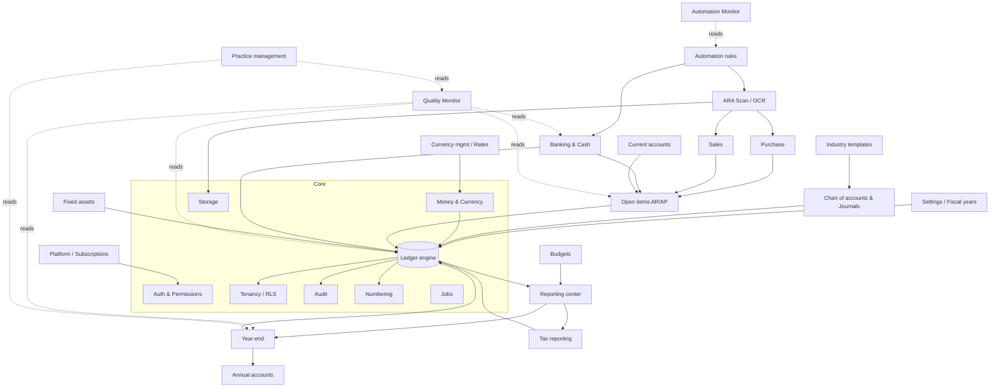

# ARA Accounting — Technical Architecture

Status: **Phase 0 deliverable — for review** (3 November 2026)
Owner: ARA Intelligent Solutions
Market: **Suriname only**. Every default, template, tax rule, bank format and term follows [SURINAME_MARKET.md](SURINAME_MARKET.md).

---

## 1. Repository audit (Phase 0 findings)

| Source | Finding | Consequence |
| --- | --- | --- |
| Session working directory | Empty. No ARA Accounting code exists. | Greenfield project, `ara-accounting`. Nothing to preserve or migrate. |
| `johnlukems-cpu/ARA-Intelligent-Solutions` | Marketing website (Next.js, nl/en). It has an Accounting product page but no application code. | Use it only for brand assets and positioning. Link "Inloggen/Demo" from the website to the app later. |
| `johnlukems-cpu/ara-payroll` | Production sister product with 14 migrations, 81 unit, 26 integration and 6 e2e tests, and a production audit in `docs/PRODUCTION_AUDIT.md`. | Reviewed for reference only. **ARA Accounting is implemented independently; no code or configuration is copied from ARA Payroll** (product owner decision, 2026-11-10). |

### Patterns reviewed in ARA Payroll (reference only, not copied)

The table lists concepts that proved themselves in ARA Payroll. ARA Accounting builds its own implementation of each one.

| Pattern | Seen in Payroll | ARA Accounting's own implementation |
| --- | --- | --- |
| Session auth: SHA-256-hashed token, HttpOnly cookie, bcrypt, login rate limit | `src/lib/server/session.ts`, `auth.ts`, `rate-limit.ts` | As is, then extended with MFA (TOTP) and organisation-level context |
| Permission matrix as single source of truth, `requirePermission` / `requirePage` | `src/lib/permissions.ts`, `src/lib/server/auth.ts` | Extended: per-permission **actions** (view/create/edit/approve/post/reverse/export/close/manage) and **per-client** assignment |
| Server actions: Zod validation, translated `UserError`, `handleError` | `src/lib/server/action.ts`, `errors.ts` | As is |
| Audit log | `src/lib/server/audit.ts` | Upgraded to an append-only, hash-chained audit log (§7) |
| ISO 4217 currency register, dated `ExchangeRate` with approval, never overwritten | `prisma/schema.prisma` (`Currency`, `ExchangeRate`) | Extended with rate types (spot/average/closing), sources and policies |
| `RateBook` resolver: company rate before platform rate, direct before inverse | `src/lib/server/rates.ts` | Generalised to `ExchangeRatePolicy` per transaction type |
| Exact BigInt currency conversion | `src/lib/currency.ts` | Replaced by a `Money` value object on `decimal.js` (§5.3), same rounding rules |
| Legal-verification status on statutory rules (`VERIFIED`, `PENDING_VERIFICATION`, …) and acknowledged approval | `LegalStatus`, `LegalSource`, declaration flow | Applied to tax rates, tax codes and annual-accounts templates. **Nothing tax-related is hard-coded.** |
| next-intl without locale routing, `nl` default, catalogue parity test | `src/i18n`, `messages/*.json`, `tests/unit/i18n.test.ts` | As is |
| PDF (pdf-lib, page-aware tables), Excel (exceljs), CSV with formula-injection guard | `src/lib/server/pdf.ts`, `csv.ts` | As is |
| S3-compatible / local storage behind an authorised download handler | `src/lib/server/storage.ts`, `src/app/api/documents` | As is, plus content hashing for duplicate detection |
| Security headers, health endpoint, Docker + Vercel build | `next.config.ts`, `Dockerfile`, `docker-compose.yml` | As is, plus CSP (open item in the payroll audit) |
| Design tokens (Tailwind 4 `@theme`), UI primitives (button, card, table, form, badge) | `src/app/globals.css`, `src/components/ui` | Re-themed to the ARA Accounting palette (deep navy + emerald) |

### Gaps that Accounting must solve (none exist in Payroll)

Gaps: a double-entry ledger, a chart of accounts, journals with gapless numbering, fiscal years and periods with locking, open-item (sub-ledger) management, bank import and matching, document OCR, budgets, report mappings, year-end closing, an accounting-firm practice layer (client portfolio, staff assignment), subscriptions and entitlements, background jobs and database-level tenant isolation.

---

## 2. Technology stack (decision)

| Layer | Choice | Reason |
| --- | --- | --- |
| Runtime | Node.js ≥ 22, TypeScript (strict) | Proven in the ARA suite |
| Web framework | **Next.js 16** App Router, React 19, server actions + route handlers | One deployable app with a typed server/client boundary. |
| Database | **PostgreSQL 16** | `NUMERIC`, row-level security, deferred constraint triggers, advisory locks, JSONB |
| ORM / migrations | **Prisma 6** (`prisma migrate`), raw SQL migrations for triggers and RLS | Proven in the ARA suite |
| Decimal maths | **decimal.js** wrapped in `src/core/money` | Decimal arithmetic required. No `number` for money. |
| Validation | Zod 4 | Proven in the ARA suite |
| i18n | next-intl, `nl` default, `en` secondary | Proven in the ARA suite |
| UI | Tailwind CSS 4, own component library, lucide-react, Recharts | ARA Accounting tokens. |
| Background jobs | **PostgreSQL job table** (`Job`, claimed with `FOR UPDATE SKIP LOCKED`) processed by Vercel functions: started immediately through `after()` and picked up by a **Vercel Cron** sweep every minute | Runs entirely on Vercel, with no extra worker. Jobs are split into short, resumable, idempotent steps that each finish well within the function time limit. |
| Files | S3-compatible object storage (local disk in development); on Vercel an S3 bucket or Vercel Blob behind the same storage interface | Same as Payroll (`S3_BUCKET` required on Vercel) |
| OCR / AI | `DocumentExtractor` interface. Implementations: PDF text layer (built-in), a vision-LLM provider (Claude API) and a manual provider. | Provider-independent. Works without AI (manual entry). |
| PDF / Excel | pdf-lib, exceljs | Proven in the ARA suite |
| Tests | Vitest (unit + integration on a real PostgreSQL), Playwright (e2e, nl + en, mobile) | Proven in the ARA suite |
| Monitoring | Structured logs (pino), `/api/health`, Sentry-compatible error hook | Open item in the Payroll audit |

**Not chosen:** a separate SPA + REST backend (doubles the auth surface, no benefit at this stage), microservices (premature) and floating-point money.

---

## 3. Layered architecture

```
src/
  app/                      Next.js routes (presentation only)
    (public)/               login, register, invitation, password reset
    app/[module]/…          authenticated application (sidebar modules)
    platform/…              platform administration (separate area and permission set)
    api/                    route handlers: downloads, exports, webhooks, PWA upload, health
  actions/                  server actions, thin: parse (Zod) → authorise → call service → audit
  modules/<module>/         one folder per business module
    domain/                 pure logic, no I/O (fully unit-tested)
    service.ts              orchestration, DB transactions, calls the ledger
    queries.ts              read models for pages and reports
    schemas.ts              Zod input schemas (shared by actions and API)
  core/
    ledger/                 THE accounting engine (only writer of posted entries)
    money/                  Money, Rate, rounding, allocation (decimal.js)
    tenancy/                request context, tenant-scoped Prisma client, RLS session vars
    auth/                   sessions, MFA, permissions, guards
    audit/                  append-only audit log
    jobs/                   job table, step runner, job registry
    storage/                object storage, hashing, virus-scan hook
    numbering/              gapless document and journal sequences
    i18n/, format/          locale-aware formatting
  integrations/             interfaces + adapters (OCR, rates, banks, email, tax filing)
  components/               design system (ui/, shell/, charts/, finance/)
app/api/jobs/run           cron-triggered job runner (protected by CRON_SECRET)
prisma/                     schema, migrations (incl. SQL for triggers/RLS), seed
tests/                      unit, integration, e2e, accounting-scenarios
docs/                       architecture, schema, rules, security, API, roadmap, manual (nl)
```

Rules:
1. **Pages never write.** All mutations go through server actions or route handlers into module services.
2. **Only `core/ledger` creates, posts or reverses `JournalEntry` rows.** Sub-ledgers call `ledger.post(proposal)`, and a lint rule (`no-restricted-imports`) enforces this.
3. `domain/` folders have no imports from Prisma, Next.js or `server-only`, so they stay deterministic and testable.
4. Every service function receives a `TenantContext` (organisation, company, administration, user, permissions). There is no global "current tenant".

---

## 4. Multi-tenant model

> **Implemented in Phase 1:** `src/core/tenancy/tenant.ts` (`withTenant`), `src/core/auth/access.ts` (access per organisation and company), `src/core/auth/context.ts` (active organisation, company, administration and fiscal year per request), `src/core/auth/permissions.ts` (role matrix).

```
Platform
 └─ Organization (kind: BUSINESS | ACCOUNTING_FIRM, subscription)
     ├─ OrganizationMembership (user, org role)        ← staff of the firm / business
     └─ Company (legal entity; for a firm = a client company)
         ├─ CompanyAssignment (user, role)              ← which staff may work on which client
         └─ Administration (books: CoA, journals, base currency SRD by default, industry, legal form, reporting framework)
             └─ FiscalYear
                 └─ AccountingPeriod (OPEN | SOFT_CLOSED | CLOSED)
                     └─ JournalEntry → JournalLine
```

- A **business** organisation gets one company and one administration created during onboarding. Firm screens are hidden; there is no forced firm structure.
- An **accounting firm** sees the Practice Management module: client portfolio, assignments, tasks, deadlines, quality per client.
- A client company may also invite its own users (Client Administrator, Read-only, Approval Manager). Their access is limited to that company.
- Effective permission = union of org-level role grants (for example, a firm admin sees all clients) and company-level assignment grants, filtered by the organisation's **plan entitlements** (module access).

### Isolation: defence in depth

1. **Application layer.** Every query goes through `tenantDb(ctx)`, a Prisma client extension that injects `organizationId` and `administrationId` filters and refuses queries on tenant tables without them.
2. **Database layer.** PostgreSQL **row-level security** on every tenant table (`organization_id = current_setting('app.org_id')`). The tenant client runs each operation in a transaction that first executes `SELECT set_config('app.org_id', …, true)`. The application DB role is not the table owner and has no `BYPASSRLS`. Migrations and the job runner's platform-level tasks use a separate role.
3. **Tests.** A tenant-isolation suite seeds two organisations and asserts that every service read and every route handler returns nothing (or 404) across tenants.

Every tenant table carries `organization_id` (denormalised) so RLS policies stay simple and indexable.

---

## 5. Accounting engine (core/ledger)

### 5.1 Responsibilities
- Accept a **posting proposal** (journal, dates, lines, source document, idempotency key).
- Validate it: the balance in base currency, accounts active and postable, the period open for the user's permission, the control-account rules, the currency/rate snapshot and the dimensions.
- Assign the **gapless entry number** per journal per fiscal year, with a counter row locked `FOR UPDATE` in the same transaction.
- Write the `JournalEntry` and `JournalLine` rows, link the source document and write the audit record, all in **one database transaction**.
- Reverse an entry: create a mirror entry linked through `reversesEntryId`. The original is never changed.
- Expose read primitives: balances per account, period and dimension, and ledger lines with drill-down to the source.

### 5.2 Entry lifecycle
`DRAFT → (SUBMITTED → APPROVED)? → POSTED → (REVERSED)`
Approval is required when the journal or the automation rule says so. A posted entry is immutable, which a database trigger enforces: it rejects `UPDATE` and `DELETE` on posted entries and their lines, except for setting `reversedByEntryId`.

### 5.3 Money and currency
- `Money { amount: Decimal, currency: string }`. Arithmetic only through `core/money`, with rounding half away from zero to the currency's minor unit (`Currency.decimals`).
- DB columns: amounts `NUMERIC(20,4)` (values always stored rounded to the currency precision), rates `NUMERIC(24,10)`.
- Each `JournalLine` stores the **transaction amount and currency**, the **rate, rate date, rate id and source**, and the **base-currency debit/credit**. The balance check runs on base-currency amounts. Optionally a reporting-currency amount is stored too.
- Rounding differences from conversion go to the administration's *rounding difference* account, through an explicit line that the engine generates and labels.

### 5.4 Sub-ledgers and open items
AR, AP, current accounts and fixed assets are **sub-ledgers on top of the general ledger**:
- Postings to a **control account** (debtors, creditors, current account, fixed assets) are allowed only from the owning module, never from manual memorial entries (configurable for opening balances).
- `OpenItem` (invoice, credit note, payment on account) carries the original and remaining amount in transaction currency. `Allocation` links payments to items. A partial allocation of a foreign-currency item calculates the **realised exchange difference** and posts it in the same transaction.
- The reconciliation control "sub-ledger total = control account balance" runs in the Quality Monitor.

### 5.5 Dimensions
Cost centre, project, department and branch are optional dimensions on journal lines, configured per administration. Budgets and reports use the same dimension keys.

### 5.6 Reporting from the ledger
All reports are queries on posted `JournalLine` rows, joined to `ReportingLine` mappings (per framework and template version). An `AccountPeriodBalance` snapshot table is maintained inside the posting transaction for fast trial balances. It is always recomputable from lines, and a nightly job verifies that it matches.

---

## 6. Module dependency diagram



Write dependencies always point *down* to the ledger. Monitors and practice management only read.

---

## 7. Cross-cutting concerns

| Concern | Design |
| --- | --- |
| Audit trail | `AuditLog` is append-only (trigger blocks update/delete). Each row stores actor, tenant, action, entity, before/after diff, IP and request id, plus `prevHash`/`hash` (SHA-256 chain per organisation) so tampering is detectable. Posting, reversal, approval, period close, permission changes, exports and downloads are always logged. |
| Approvals | A generic `Approval` (subject type/id, step, required permission, decision, comment, actor). It is used by invoices, journal entries, budgets, rates, depreciation runs, year-end and tax returns. Segregation of duties is configurable per administration: the creator cannot approve their own item. |
| Idempotency | Every posting proposal carries `idempotencyKey`, with a unique index on (`administration_id`, `idempotency_key`). Bank import lines carry a content hash. Revaluation runs are unique per (administration, period, rate set). |
| Numbering | `NumberSequence` (scope, fiscal year, prefix, next value) is locked `FOR UPDATE`. Numbers are gapless for posted journal entries and sales invoices, and assigned at posting or finalisation, not at draft. |
| Jobs | Job types: `ocr.extract`, `bank.import`, `fx.revalue`, `assets.depreciate`, `reports.generate`, `quality.scan`, `balances.verify`. Each job is tenant-scoped, idempotent, retried with backoff and recorded in `AutomationExecution`. |
| Notifications | An in-app `Notification` table. Email goes through an `EmailSender` interface (SMTP adapter). |
| i18n / formatting | `nl-SR` formats (Surinamese Dutch terminology), `en` secondary. Currency is always shown with its ISO code (SRD 38.000,00), never a bare "$". |
| Feature entitlements | `Plan` → `PlanEntitlement` (module, limit). `requireModule(ctx, "budgets")` is checked server-side next to permissions. |

---

## 8. Integration interfaces (built as adapters; "operational" only after a real test)

| Interface | First adapters | Notes |
| --- | --- | --- |
| `DocumentExtractor` | PDF text layer + heuristics; vision LLM (Claude API); manual | Returns fields with confidence and a raw extraction log. Sending documents to an external AI requires organisation consent (setting) because of data protection. |
| `ExchangeRateProvider` | Manual; **CBvS** (daily weighted buy/sell, monthly averages); bank or cambio rate taken from the statement or receipt | Rates arrive as `PENDING` unless the administration auto-approves CBvS. |
| `BankStatementParser` | CSV/Excel with a saved column mapping per Surinamese bank; PDF statements via ARA Scan | Profiles for DSB, Hakrinbank, Finabank, Republic Bank, Southern Commercial Bank, Godo, Volkscredietbank and others are added once sample files are received. No CAMT/MT940 until a Surinamese bank supplies them. |
| `BankConnector` | none (interface only) | For a future Surinamese bank API, if one becomes available |
| `EmailSender` | SMTP | Invoice delivery, invitations, reminders |
| `EmailIngest` | interface only | Forward-to-scan mailbox (Phase 7+) |
| `TaxFilingChannel` | Filing-ready BTW and inkomstenbelasting documents (PDF/Excel) for the Belastingdienst Suriname | No claim of electronic filing; an e-filing adapter only if the Belastingdienst offers one |
| `PayrollJournalImport` | ARA Payroll export (CSV/JSON) | Posts salaries, loonbelasting, AOV and contributions payable into Accounting |
| `PaymentListExport` | CSV per Surinamese bank | Formats once bank specifications are confirmed |

---

## 9. Deployment

- No local hyperscale cloud exists in Suriname. Use the closest region (US-East or São Paulo), disclose this in the terms, and offer full data export. ARA Scan is offline-tolerant for unreliable connections.
- **Platform: Vercel** (decided by the product owner, the same as ARA Payroll). The function region is `iad1` (Washington DC, US-East), the closest region to Suriname, and the database sits in the same region.
- **Database:** managed PostgreSQL 16 (Neon through the Vercel Marketplace, or another provider in US-East). The pooled connection string is used for the app and the direct one for migrations. RLS policies and triggers are created by SQL migrations.
- **Build:** `vercel-build` = `prisma generate && prisma migrate deploy && seed reference data && next build` . Preview deployments use a separate preview database branch, never production data.
- **Files:** an S3 bucket (`S3_BUCKET`) or Vercel Blob for documents, scans and generated PDFs. Never the function filesystem.
- **Background work on Vercel:** OCR, bank imports, revaluation, depreciation runs and report packs are queued in the `Job` table. They start immediately via `after()` and are retried by a Vercel Cron call to `/api/jobs/run` every minute. Each job step is short and resumable (for example one document per OCR step, 500 bank lines per import step, one report section per step), and a step's progress is committed before the next starts. Large Excel/PDF report packs are generated in steps and assembled at the end.
- **Limits to watch:** function duration (set `maxDuration` per route; Pro plan needed for longer steps and minute-level cron), request body size for uploads (documents go **directly from the browser to storage** with a signed upload URL, not through a function), and database connections (pooled).
- **Environment variables:** `DATABASE_URL`, `DIRECT_URL`, `SESSION_SECRET`, `ENCRYPTION_KEY`, `CRON_SECRET`, `S3_*` or `BLOB_READ_WRITE_TOKEN`, `AI_PROVIDER_KEY` (optional), `SMTP_*`, all set in the Vercel project settings and never committed.
- Environments: development, staging, production. Migrations run with `prisma migrate deploy` in the release step. Seeds are idempotent and load reference data (currencies, industry templates, report templates).
- Backups: daily logical and continuous WAL (provider PITR), with a restore test each quarter documented in `docs/OPERATIONS.md`.

---

## 10. Open decisions (need product-owner input)

1. **Repository.** Create `johnlukems-cpu/ara-accounting` on GitHub (recommended). This session can't create it.
2. **Hosting.** ~~Container or Vercel~~ **Decided: Vercel** (region `iad1`) with managed PostgreSQL and S3/Vercel Blob.
3. **AI provider and data consent for ARA Scan.** Default: off until an organisation enables it. Manual and PDF-text extraction always work.
4. **Shared login with ARA Payroll.** Recommended later (Phase 11): a shared identity service, and for now separate user tables with the same patterns.
5. **Annual-accounts templates to ship first.** Recommended: NV under the Wet op de Jaarrekening (S.B. 2017 no. 84) on an IFRS for SMEs basis, eenmanszaak/VOF with a samenstellingsverklaring, and stichting/kerkgenootschap. All are marked *pending professional verification* (see SURINAME_MARKET.md §6).
6. **Professional reviewers.** A Surinamese tax advisor and a SUVA-registered accountant to verify the tax and annual-accounts configuration before launch.
