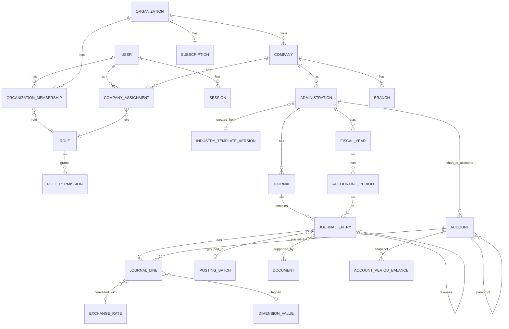
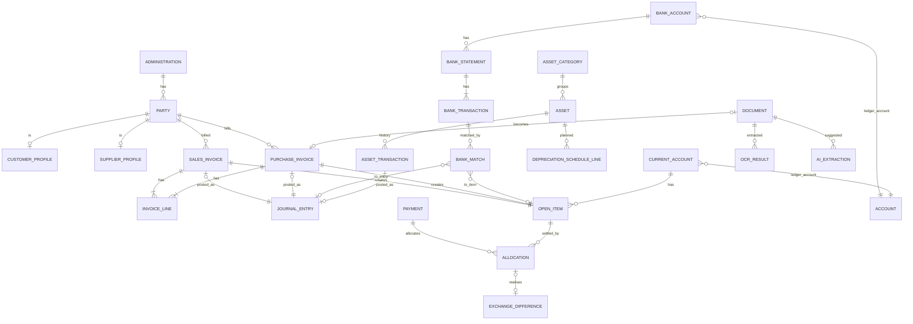
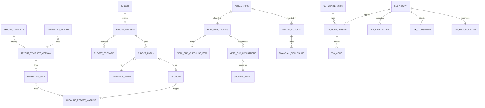

# ARA Accounting — Database Schema (logical design)

Status: **Phase 0 design**. The Prisma schema is written per phase from this document, and this file is updated alongside each migration.

Conventions
- PostgreSQL 16. **Prisma default naming** (decided in Phase 1): table names are the model names (`"JournalEntry"`) and columns camelCase (`"organizationId"`); the snake_case names used below are descriptive. Primary keys are `cuid()` text, except reference tables keyed by code (currency ISO code) and the audit log (`seq` bigint).
- Every tenant table has `organizationId`, plus `administrationId` where the data belongs to a set of books. RLS policy on `organizationId` via `ara_enable_tenant_rls()` (see the Phase 1 security migration).
- Implemented so far: see `prisma/schema.prisma` (Phase 1: identity, tenancy, roles, companies, branches, administrations, fiscal years, periods, audit log, notifications).
- Money columns are `NUMERIC(20,4)`, rates `NUMERIC(24,10)` and percentages `NUMERIC(9,4)`. Never `float`.
- Timestamps are `timestamptz`. Accounting dates (`entry_date`, `document_date`, …) are `date`.
- Soft states (`ACTIVE`/`ARCHIVED`) instead of deletes for master data that is referenced by postings.
- `created_by_id`, `created_at`, `updated_at` on all mutable tables.

---

## 1. Core ERD (identity, tenancy, ledger)

## 2. Operations ERD (sub-ledgers, bank, assets)

## 3. Planning, reporting, closing ERD

---

## 4. Model catalogue

Key: **PK** primary key, **U** unique, **IX** index, **FK** foreign key, **CHK** check / trigger.

### 4.1 Identity and organisation
| Model | Key fields | Constraints |
| --- | --- | --- |
| `User` | email, name, passwordHash, locale, mfaSecret (encrypted), mfaEnabled, isPlatformAdmin, isActive | U(email) |
| `Session` | id = SHA-256(token), userId, activeOrganizationId, activeCompanyId, activeAdministrationId, activeFiscalYearId, expiresAt, mfaVerifiedAt | IX(userId) |
| `Organization` | name, kind (BUSINESS, ACCOUNTING_FIRM), status (TRIAL, ACTIVE, SUSPENDED, CANCELLED), defaultLocale (`nl-SR`) | |
| `OrganizationMembership` | organizationId, userId, roleId, status (INVITED, ACTIVE, DISABLED) | U(organizationId, userId) |
| `Role` | organizationId (null = system role), code, name, isSystem | U(organizationId, code) |
| `Permission` | code (`ledger.post`, `sales.approve`, …), module, action | PK(code) |
| `RolePermission` | roleId, permissionCode | U(roleId, permissionCode) |
| `Company` | organizationId, name, legalName, legalForm (EENMANSZAAK, VOF, CV, NV, STICHTING, VERENIGING, COOPERATIE, OVERHEIDS_NV, KERKGENOOTSCHAP), kkfNumber, taxNumber, btwNumber, isBtwRegistered, address, district (PARAMARIBO, WANICA, NICKERIE, CORONIE, SARAMACCA, COMMEWIJNE, MAROWIJNE, PARA, BROKOPONDO, SIPALIWINI), status, ownerUserId | IX(organizationId); U(organizationId, kkfNumber) where not null |
| `CompanyAssignment` | companyId, userId, roleId, validFrom, validTo | U(companyId, userId) |
| `Branch` | companyId, code, name | U(companyId, code) |
| `Administration` | companyId, organizationId, name, code, baseCurrency (default SRD), reportingCurrency, framework (annual-accounts template), industryTemplateVersionId, status (SETUP, ACTIVE, ARCHIVED), settings (JSONB: approval rules, SoD, rounding account …) | U(companyId, code) |
| `FiscalYear` | administrationId, code ("2026"), startDate, endDate, status (OPEN, CLOSING, CLOSED) | U(administrationId, code); CHK no overlap (exclusion constraint on daterange) |
| `AccountingPeriod` | fiscalYearId, number (0 = opening, 1..12, 13 = closing), startDate, endDate, status (OPEN, SOFT_CLOSED, CLOSED), closedById, closedAt | U(fiscalYearId, number) |

### 4.2 Ledger

> **Implemented (Phase 2):** `Account`, `Journal`, `JournalEntry`, `JournalLine`, `DimensionValue`, `NumberSequence`. Decisions: opening balances are period-0 entries in the OPN journal (no separate `OpeningBalance` table); `PostingBatch` and `AccountPeriodBalance` are deferred until a module needs them (the trial balance is computed from indexed posted lines; Phase 12 load tests decide on the snapshot table). Party and tax-code columns on lines exist and get their foreign keys in Phase 3.

| Model | Key fields | Constraints |
| --- | --- | --- |
| `Account` (ChartOfAccount) | administrationId, number, name, nameEn, description, category (ASSET, LIABILITY, EQUITY, REVENUE, COST_OF_SALES, OPERATING_EXPENSE, FINANCIAL_INCOME, FINANCIAL_EXPENSE, TAX, SUSPENSE), type (DETAIL, HEADER), parentId, normalBalance (DEBIT, CREDIT), controlType (NONE, RECEIVABLE, PAYABLE, BANK, CASH, CURRENT_ACCOUNT, FIXED_ASSET, TAX, ROUNDING, FX_RESULT, RETAINED_EARNINGS), currencyRestriction, defaultTaxCodeId, requiresDimensions, status (ACTIVE, ARCHIVED), templateAccountRef | U(administrationId, number); CHK posting only to DETAIL accounts |
| `Journal` | administrationId, code, name, type (PURCHASE, SALES, BANK, CASH, GENERAL, OPENING, FIXED_ASSET, DEPRECIATION, TAX, FX_ADJUSTMENT, CLOSING), requiresApproval, defaultAccountId, bankAccountId, status | U(administrationId, code) |
| `JournalEntry` | organizationId, administrationId, journalId, fiscalYearId, periodId, entryNumber, entryDate, documentDate, postingDate, description, reference, currency, status (DRAFT, SUBMITTED, APPROVED, POSTED), sourceType (MANUAL, SALES_INVOICE, PURCHASE_INVOICE, PAYMENT, BANK, ASSET, DEPRECIATION, FX_REVALUATION, YEAR_END, OPENING, TAX, IMPORT), sourceId, postingBatchId, reversesEntryId, reversedByEntryId, idempotencyKey, createdById, approvedById, postedById, postedAt, totalDebitBase, totalCreditBase | U(administrationId, idempotencyKey); U(journalId, fiscalYearId, entryNumber) where posted; IX(administrationId, periodId, status); **CHK trigger: posted = immutable; deferred trigger: Σdebit = Σcredit (base) at commit** |
| `JournalLine` | entryId, organizationId, administrationId, lineNo, accountId, description, debitBase, creditBase, txCurrency, txAmount (signed), exchangeRate, rateDate, exchangeRateId, rateSource, reportingAmount, taxCodeId, taxBaseAmount, partyId, openItemId, costCenterId, projectId, departmentId, branchId, quantity | CHK (debitBase ≥ 0, creditBase ≥ 0, exactly one > 0); IX(administrationId, accountId, periodId); IX(partyId); immutability via parent status |
| `PostingBatch` | administrationId, kind (IMPORT, DEPRECIATION_RUN, REVALUATION, YEAR_END, AUTOMATION), status, createdById | |
| `ReversalEntry` | (realised as `JournalEntry.reversesEntryId` + `reason`, `reversalType` CORRECTION / REVERSAL) | |
| `OpeningBalance` | administrationId, fiscalYearId, accountId, partyId?, amountBase, txCurrency, txAmount, source (MANUAL, IMPORT, YEAR_END_CARRY_FORWARD), entryId | U(fiscalYearId, accountId, partyId, txCurrency) |
| `AccountPeriodBalance` | administrationId, accountId, periodId, txCurrency, debitBase, creditBase, txAmount | U(accountId, periodId, txCurrency) — derived and verifiable |
| `NumberSequence` | scope (JOURNAL, SALES_INVOICE, …), scopeId, fiscalYearId, prefix, nextValue | U(scope, scopeId, fiscalYearId) |
| `Dimension` / `DimensionValue` | administrationId, type (COST_CENTER, PROJECT, DEPARTMENT), code, name, status | U(administrationId, type, code) |

### 4.3 Parties, invoices, payments, open items
| Model | Key fields | Constraints |
| --- | --- | --- |
| `Party` | administrationId, code, name, isCustomer, isSupplier, registrationNumber, taxNumber, email, phone, address, currency, paymentTermDays, defaultAccountId, defaultTaxCodeId, kkfNumber, btwNumber, district, bankName, bankAccountNumber, bankAccountCurrency, status | U(administrationId, code); IX(administrationId, name) |
| `SalesInvoice` | administrationId, partyId, number (assigned on finalise), kind (INVOICE, CREDIT_NOTE), creditsInvoiceId, invoiceDate, dueDate, currency, rate snapshot, netAmount, taxAmount, grossAmount, status (DRAFT, FINALISED, SENT, PARTIALLY_PAID, PAID, CANCELLED_BY_CREDIT), templateId, pdfDocumentId, entryId, sentAt | U(administrationId, number) where not null |
| `PurchaseInvoice` | administrationId, partyId, supplierInvoiceNumber, kind, invoiceDate, dueDate, currency, amounts, status (DRAFT, REVIEW, APPROVED, POSTED, PARTIALLY_PAID, PAID), documentId, entryId | U(administrationId, partyId, supplierInvoiceNumber, kind) — duplicate guard |
| `InvoiceLine` | invoiceType, invoiceId, lineNo, description, quantity, unitPrice, discountPct, netAmount, taxCodeId, taxAmount, accountId, costCenterId, projectId | |
| `CreditNote` | realised as `kind = CREDIT_NOTE` on both invoice tables, with `creditsInvoiceId` | |
| `Payment` | administrationId, direction (IN, OUT), partyId?, bankTransactionId?, cashAccountId?, date, currency, amount, rate snapshot, entryId, status | |
| `OpenItem` | administrationId, partyId or currentAccountId, sourceType, sourceId, side (RECEIVABLE, PAYABLE), currency, originalAmount, remainingAmount, originalRate, dueDate, status (OPEN, PARTIAL, SETTLED) | IX(administrationId, partyId, status) |
| `Allocation` | openItemId, paymentId or counterOpenItemId, amountTx, amountBaseAtItemRate, amountBaseAtPaymentRate, exchangeDifferenceId, entryId | |

### 4.4 Banking and current accounts
| Model | Key fields | Constraints |
| --- | --- | --- |
| `BankAccount` | administrationId, name, bankCode (DSB, HAKRIN, FINA, REPUBLIC, SCB, GODO, VCB, SPSB, AMANAH, OTHER), accountNumber (local, no IBAN), currency, ledgerAccountId, journalId, kind (BANK, CASH, CAMBIO_CASH), importProfileId | U(administrationId, bankCode, accountNumber, currency) |
| `BankImportProfile` | administrationId, bankCode, format (CSV, XLSX, PDF_VIA_SCAN), columnMapping (JSONB), dateFormat, decimalSeparator | |
| `BankStatement` | bankAccountId, statementNumber, fromDate, toDate, openingBalance, closingBalance, fileDocumentId, fileHash | U(bankAccountId, fileHash) |
| `BankTransaction` | statementId, bankAccountId, bookingDate, valueDate, amount, currency, counterpartyName, counterpartyAccount, description, bankReference, lineHash, status (UNMATCHED, PARTIAL, MATCHED, IGNORED) | U(bankAccountId, lineHash) — duplicate import guard |
| `BankMatch` | bankTransactionId, targetType (OPEN_ITEM, ENTRY, NEW_ENTRY), targetId, amount, matchedBy (USER, RULE, SUGGESTION_ACCEPTED), confidence | |
| `BankReconciliation` | bankAccountId, periodEnd, statementBalance, ledgerBalance, difference, status, approvedById | |
| `CurrentAccount` | administrationId, kind (DIRECTOR, SHAREHOLDER, INTERCOMPANY, RELATED_PARTY), counterpartyName, counterpartyCompanyId?, ledgerAccountId, currency, interestRate, agreementDocumentId | |

### 4.5 Fixed assets
| Model | Key fields |
| --- | --- |
| `AssetCategory` | administrationId, code, name, assetAccountId, accumulatedDepAccountId, depExpenseAccountId, disposalGainAccountId, disposalLossAccountId, defaultMethod, defaultUsefulLifeMonths, defaultResidualPct |
| `Asset` | administrationId, categoryId, number, name, acquisitionDate, acquisitionCost, currency (base), residualValue, usefulLifeMonths, method (STRAIGHT_LINE, DECLINING_BALANCE, CUSTOM), decliningRate, depreciationStart, status (ACTIVE, FULLY_DEPRECIATED, DISPOSED, SOLD), location, costCenterId, sourcePurchaseInvoiceLineId |
| `DepreciationScheduleLine` | assetId, periodId, plannedAmount, postedAmount, entryId, status (PLANNED, PROPOSED, POSTED) — U(assetId, periodId) |
| `AssetTransaction` | assetId, type (ACQUISITION, IMPROVEMENT, DEPRECIATION, IMPAIRMENT, TRANSFER, DISPOSAL, SALE), date, amount, entryId, details |

### 4.6 Industry templates
| Model | Key fields |
| --- | --- |
| `IndustryTemplate` | code (U), name, nameEn, description, ownerOrganizationId (null = platform), status (ACTIVE, ARCHIVED) |
| `IndustryTemplateVersion` | templateId, version, publishedAt, changelog, content (JSONB: accounts, journals, tax mappings, report mappings, KPIs, budget categories, workflows, controls) — immutable once published; U(templateId, version) |
| `IndustryAccountMapping` | templateVersionId, templateAccountRef, number, name, category, controlType, parentRef |
| `IndustryReportingMapping` | templateVersionId, templateAccountRef, reportTemplateCode, reportingLineCode |

Applying a template **copies** rows into the administration (with `templateAccountRef` kept). Template upgrades produce a *diff proposal*: new accounts are offered and changed mappings are shown, and nothing is overwritten silently.

### 4.7 Currency
| Model | Key fields |
| --- | --- |
| `Currency` | code PK, name, nameNl, symbol, decimals, isActive |
| `ExchangeRateSource` | code (MANUAL, CBVS, BANK_STATEMENT, CAMBIO_RECEIPT), name, config, isActive |
| `ExchangeRate` | organizationId? (null = platform), administrationId?, base, quote, rateType (CBVS_BUY, CBVS_SELL, CBVS_MID, CBVS_MONTH_AVG, CLOSING, BANK, CAMBIO, MANUAL), rate, effectiveDate, sourceId, status (PENDING, APPROVED, REJECTED), approvedById — never updated after approval |
| `ExchangeRatePolicy` | administrationId, transactionType (SALES, PURCHASE, BANK, REVALUATION, REPORTING_PL, REPORTING_BS), rateType, sourcePriority, dateBasis (DOCUMENT, POSTING, PAYMENT), requireApproved |
| `CurrencyRevaluation` | administrationId, periodId, revaluationDate, rateSetHash, scope, status (PROPOSED, POSTED, REVERSED), entryId, autoReverseEntryId — U(administrationId, periodId, scope) where status = POSTED |
| `ExchangeDifference` | administrationId, kind (REALISED, UNREALISED), sourceType, sourceId, currency, txAmount, rateFrom, rateTo, amountBase, entryId |

### 4.8 Budgets
`Budget` (administrationId, fiscalYearId, name, type, dimensionScope, currency, status: DRAFT, SUBMITTED, REVIEW, APPROVED, ACTIVE, CLOSED) → `BudgetVersion` (version, basis: MANUAL, IMPORT, PRIOR_ACTUALS, PRIOR_BUDGET, AVERAGE; adjustmentPct; approved versions immutable) → `BudgetEntry` (accountId, periodNumber, dimension ids, amount) • `BudgetScenario` (BEST, BASE, WORST, assumptions JSONB) • `BudgetApproval` (via generic `Approval`) • `BudgetForecast` (versionId, asOfPeriod, method, assumptions, lines) • `BudgetAlertThreshold` (administrationId, pct, level).

### 4.9 Reporting, year-end, annual accounts
`ReportTemplate` / `ReportTemplateVersion` / `ReportingLine` (code, parent, sign, kind: BALANCE_SHEET, PROFIT_LOSS, CASHFLOW_DIRECT/INDIRECT, EQUITY) / `AccountReportMapping` (administration override of template mapping) • `ReportPeriod` • `GeneratedReport` (parameters, data snapshot JSONB, documentId, generatedById, ledgerHash, so a report records exactly which data it was built on) • `YearEndClosing` (fiscalYearId U, status: DRAFT, REVIEW, ADJUSTMENTS, FINAL_REVIEW, APPROVAL, CLOSED) • `YearEndChecklistItem` (code, mandatory, status, assigneeId, dueDate, evidenceDocumentIds, comments, completedAt, approvedById) • `YearEndAdjustment` (type, entryId) • `AnnualAccount` (fiscalYearId, frameworkTemplateVersionId, status: DRAFT, REVIEW, APPROVED, FINAL, content JSONB, comparativeFiscalYearId, pdfDocumentId) • `FinancialDisclosure` (annualAccountId, code, title, body rich text, order, auto/manual).

### 4.10 Tax
`TaxJurisdiction` (Suriname; kept as a table so rules stay data) • `TaxRuleVersion` (jurisdictionId, taxType: BTW, IB_RECHTSPERSONEN, IB_NATUURLIJKE_PERSONEN, DIVIDENDBELASTING, HUURWAARDEBELASTING, OTHER; effectiveFrom/To; parameters JSONB: rates, brackets, thresholds; legalStatus; citations) • `TaxCode` (administrationId, code, name, ruleVersionId, rate, direction: SALES, PURCHASE; deductiblePct, taxAccountId, reportBox) • `TaxConfiguration` (administrationId, isBtwOndernemer, BTW period = month, voorlopige aanslag amounts and instalments, tax holiday until) • `TaxReturn` (administrationId, taxType, periodFrom/To, status: DRAFT, DATA_COLLECTION, CALCULATION, REVIEW, APPROVAL, READY_FOR_FILING, FILED, ARCHIVED; filedAt only with `filingEvidenceDocumentId`) • `TaxCalculation` (returnId, lines JSONB with source drill-down keys) • `TaxAdjustment` (fiscal adjustment: kind, amount, reason, accountId?) • `TaxReconciliation` (returnId, ledgerAmount, returnAmount, difference, explanation).

### 4.11 Documents, AI, automation, quality
`Document` (organizationId, administrationId, storageKey, fileName, mimeType, sizeBytes, sha256, pages, status: DRAFT, UPLOADED, PROCESSING, RECOGNIZED, REVIEW_REQUIRED, APPROVED, POSTED, ARCHIVED; uploadedById; source: WEB, MOBILE, EMAIL, IMPORT) — IX(administrationId, sha256) • `OCRResult` (documentId, provider, rawText, layout JSONB, durationMs) • `AIExtraction` (documentId, provider, model, fields JSONB `{value, confidence, source}`, suggestions JSONB, acceptedFields, correctedFields) • `AutomationRule` (administrationId, trigger, conditions JSONB, actions JSONB, mode: SUGGEST, AUTO_WITH_APPROVAL, AUTO; minConfidence; requiredPermission; enabled) • `AutomationExecution` (ruleId?, jobName, subject, status: SUCCEEDED, FAILED, SKIPPED, OVERRIDDEN; durationMs, error, outcome: SUGGESTED, APPROVED, EXECUTED) • `QualityIssue` (administrationId, checkCode, severity: ERROR, WARNING, INFO; subjectType/Id; message key + params; recommendedAction; assigneeId; status: OPEN, IN_PROGRESS, RESOLVED, ACCEPTED, FALSE_POSITIVE; resolvedById, resolution note; fingerprint U(administrationId, fingerprint) so rescans do not duplicate).

### 4.12 Governance and SaaS
`Approval` (organizationId, subjectType, subjectId, step, requiredPermission, status, decidedById, decidedAt, comment) • `AuditLog` (append-only, hash-chained; see SECURITY.md) • `Notification` • `Plan` (code, name, billing periods, isActive) • `PlanEntitlement` (planId, module, limitKey, limitValue) • `Subscription` (organizationId U, planId, period: MONTHLY, ANNUAL; status: TRIAL, ACTIVE, PAST_DUE, SUSPENDED, CANCELLED; trialEndsAt, currentPeriodEnd) • `SubscriptionInvoice` • `SubscriptionPayment` (method MANUAL_BANK, reference, confirmedById) • `UsageRecord` (organizationId, metric: USERS, ADMINISTRATIONS, DOCUMENTS_PROCESSED, STORAGE_BYTES, month, value) • `PlatformSetting`.

### 4.13 Practice management
`Task` (organizationId, companyId?, administrationId?, title, type, assigneeId, dueDate, status, recurrence, linkedSubject) • `Deadline` (companyId, kind: BTW_AANGIFTE, IB_AANGIFTE, VOORLOPIGE_AANSLAG_TERMIJN, DIVIDENDBELASTING, JAARREKENING, KKF …, dueDate, status) • `ClientNote`.

---

## 5. Database-level safeguards (SQL in migrations)

1. `journal_entry_immutable` trigger: rejects UPDATE/DELETE of POSTED entries and their lines (only `reversed_by_entry_id` may be set once).
2. `journal_entry_balanced` deferred constraint trigger: at commit, every POSTED entry has `Σdebit_base = Σcredit_base` and at least two lines.
3. `period_open_on_post` trigger: posting into a CLOSED period is rejected even if the application check is bypassed.
4. `audit_log_append_only` trigger.
5. Exclusion constraint against overlapping fiscal years per administration (`btree_gist`).
6. RLS policies on all tenant tables. The application role has no BYPASSRLS.
7. Partial unique indexes for gapless numbers and idempotency keys.
