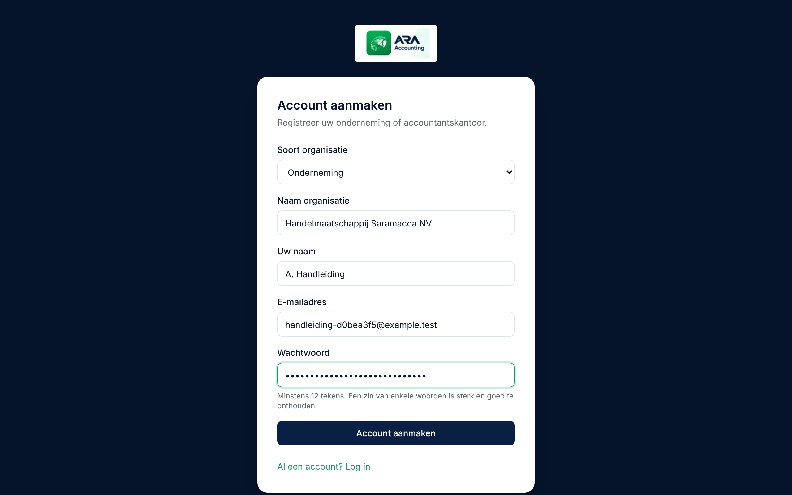
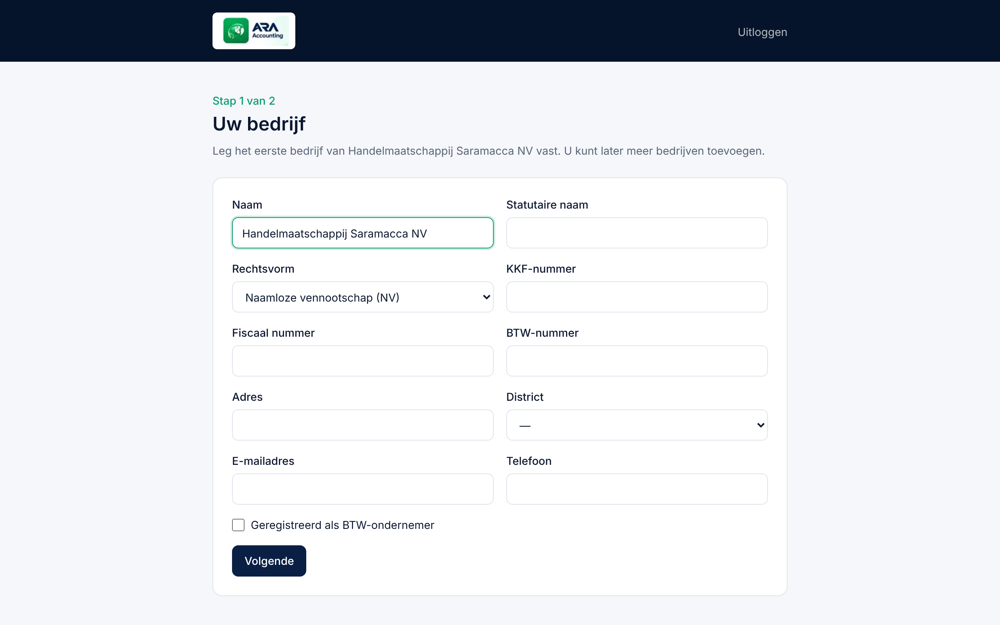
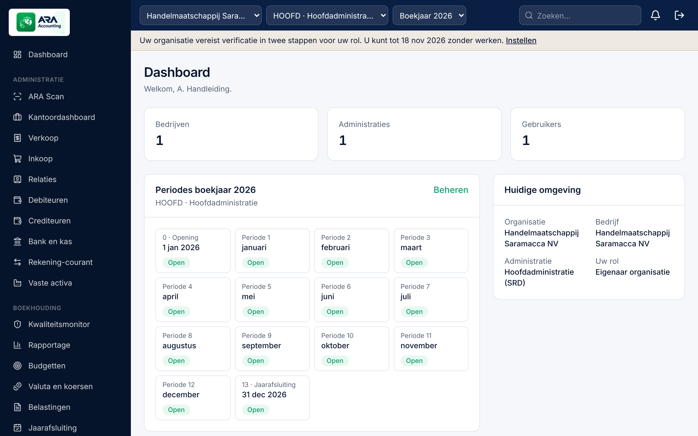
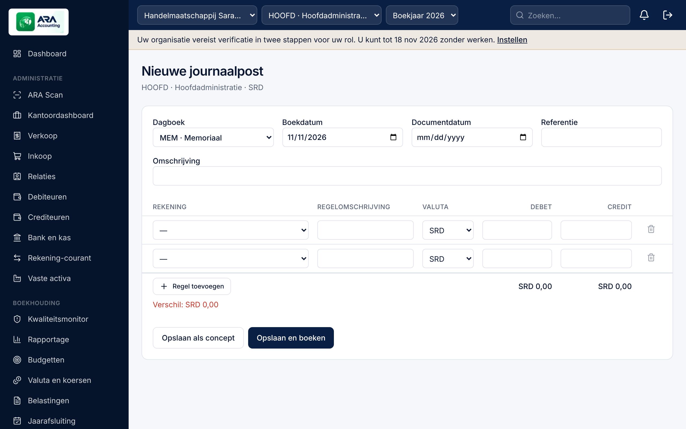
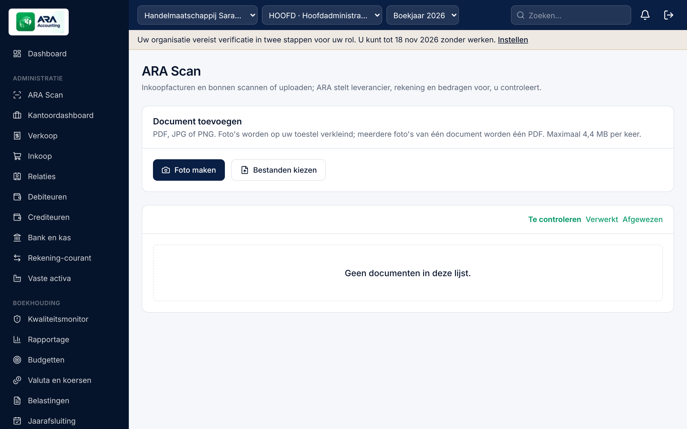
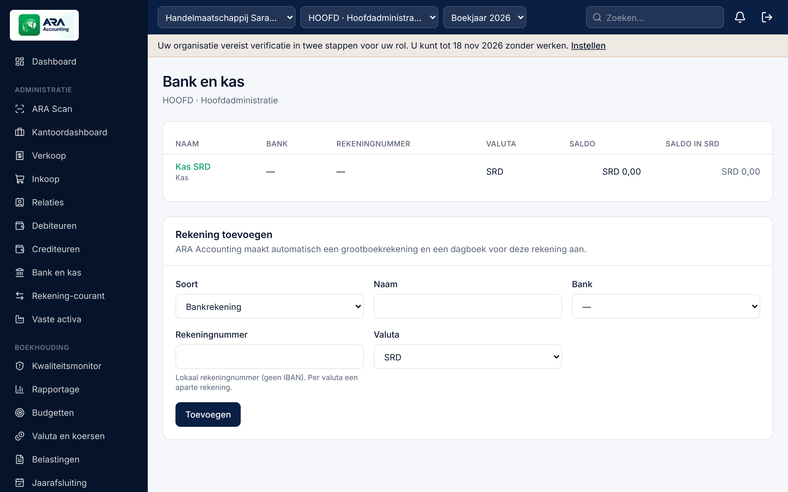
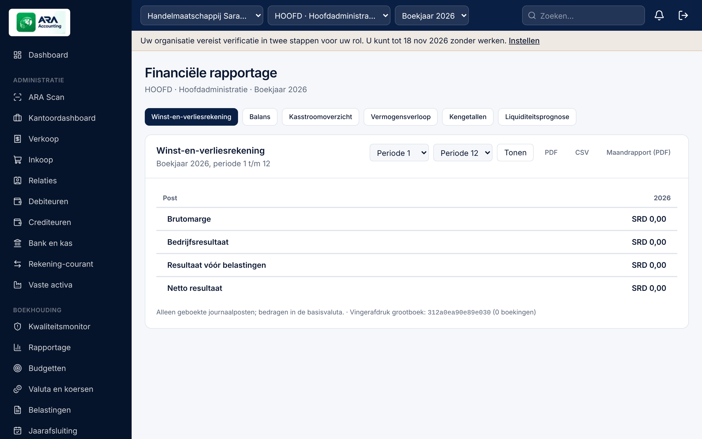
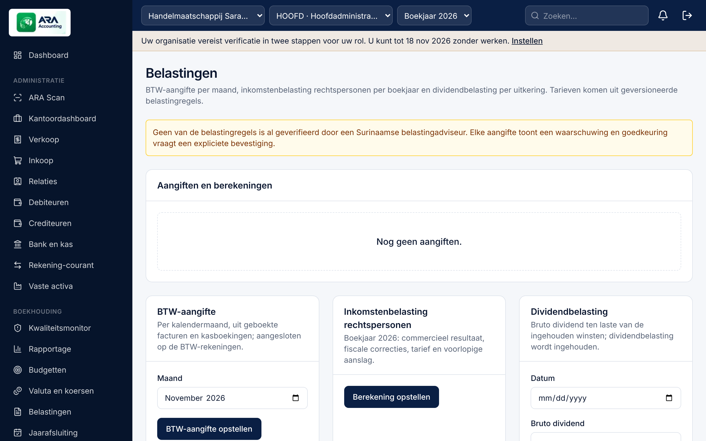
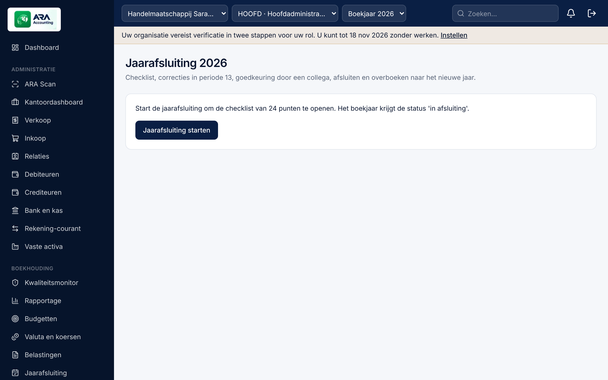

# ARA Accounting — Handleiding

Versie 1.0 (release-kandidaat, november 2026) · ARA Intelligent Solutions

Deze handleiding beschrijft ARA Accounting zoals het is gebouwd. De menunamen staan **vetgedrukt** zoals ze in het
hoofdmenu verschijnen. Schermafbeeldingen staan in `docs/manual/` en worden met `npm run manual:screenshots`
opnieuw gemaakt, zodat ze altijd bij de huidige versie horen.

> **Belangrijk.** De belastingtarieven, termijnen en wettelijke teksten in ARA Accounting zijn instelbare gegevens met
> een *wettelijke status*. Zolang een regel niet de status **Geverifieerd** heeft, toont het systeem dat duidelijk. Laat
> aangiften en jaarrekeningen altijd controleren door uw belastingadviseur of een SUVA-geregistreerde accountant.

## Inhoud

1. [Kennismaking](#1-kennismaking)
2. [Registreren en inloggen](#2-registreren-en-inloggen)
3. [Beveiliging van uw account](#3-beveiliging-van-uw-account)
4. [Eerste inrichting: bedrijf, administratie en boekjaar](#4-eerste-inrichting-bedrijf-administratie-en-boekjaar)
5. [Het scherm: menu, context en zoeken](#5-het-scherm-menu-context-en-zoeken)
6. [Gebruikers, rollen en functiescheiding](#6-gebruikers-rollen-en-functiescheiding)
7. [Rekeningschema, dagboeken en dimensies](#7-rekeningschema-dagboeken-en-dimensies)
8. [Branchesjablonen](#8-branchesjablonen)
9. [Journaalposten](#9-journaalposten)
10. [Relaties](#10-relaties)
11. [Verkoopfacturen en debiteuren](#11-verkoopfacturen-en-debiteuren)
12. [Inkoopfacturen en crediteuren](#12-inkoopfacturen-en-crediteuren)
13. [ARA Scan](#13-ara-scan)
14. [Automatisering en AI](#14-automatisering-en-ai)
15. [Bank en kas](#15-bank-en-kas)
16. [Valuta en koersen](#16-valuta-en-koersen)
17. [Vaste activa](#17-vaste-activa)
18. [Rekening-courant](#18-rekening-courant)
19. [Budgetten en prognose](#19-budgetten-en-prognose)
20. [Rapportage](#20-rapportage)
21. [Belastingen](#21-belastingen)
22. [Jaarafsluiting](#22-jaarafsluiting)
23. [Jaarrekening](#23-jaarrekening)
24. [Kwaliteitsmonitor en kantoordashboard](#24-kwaliteitsmonitor-en-kantoordashboard)
25. [Abonnement, auditlog en ondersteuning](#25-abonnement-auditlog-en-ondersteuning)

---

## 1. Kennismaking

ARA Accounting is een online boekhoudpakket voor ondernemingen en accountantskantoren in **Suriname**. Het werkt met
de Surinaamse dollar (SRD) als standaard basisvaluta en ondersteunt USD, EUR en andere valuta met koersen van de
Centrale Bank van Suriname (CBvS), de bank of een cambio.

De belangrijkste spelregels:

- **Dubbel boekhouden.** Elke boeking heeft evenveel debet als credit. Het systeem weigert een post die niet in balans is.
- **Geboekt is definitief.** Een geboekte post kan niet worden gewijzigd of verwijderd. Een fout herstelt u met een
  tegenboeking of een correctiepost. Zo blijft de administratie controleerbaar.
- **Alles wordt vastgelegd.** Elke wijziging komt in het auditlog, met wie, wat en wanneer.
- **Uw gegevens zijn van u.** Organisaties zien nooit elkaars gegevens; de database dwingt dat af.
- **AI doet voorstellen.** De kunstmatige intelligentie in ARA Scan doet alleen voorstellen. U beslist, behalve als u
  zelf een automatiseringsregel met strikte grenzen instelt (hoofdstuk 14).

ARA Accounting is beschikbaar in het **Nederlands** (standaard) en het **Engels**. U kiest de taal onder **Mijn account**
of met de taalkeuze op de inlogpagina.

## 2. Registreren en inloggen

1. Ga naar de registratiepagina en kies de **Soort organisatie**: *Onderneming* of *Accountants- of
   administratiekantoor*. Een kantoor beheert de administraties van meerdere klanten.
2. Vul de **Naam organisatie**, **Uw naam**, uw **E-mailadres** en een **Wachtwoord** van minstens 12 tekens in. Een zin
   van enkele woorden is sterk en goed te onthouden.
3. Klik op **Account aanmaken**. U komt direct in de inrichting (hoofdstuk 4).

Een nieuwe organisatie start met een **proefperiode** (hoofdstuk 25).

**Inloggen.** Vul uw e-mailadres en wachtwoord in. Na vijf mislukte pogingen binnen 15 minuten wordt inloggen voor dat
e-mailadres tijdelijk geblokkeerd.

**Wachtwoord vergeten.** Klik op *Wachtwoord vergeten?* en vul uw e-mailadres in. U ontvangt een herstellink die één
uur geldig is. Is e-mail nog niet ingesteld door de beheerder van het platform, dan kan de beheerder van uw organisatie
onder **Gebruikers** een herstellink voor u maken.

**Sessies.** U wordt na 2 uur zonder activiteit automatisch uitgelogd, en in elk geval na 12 uur.

## 3. Beveiliging van uw account

Onder **Mijn account** beheert u uw profiel, taal, wachtwoord en **verificatie in twee stappen**.

1. Klik bij *Verificatie in twee stappen* op **Instellen**.
2. Scan de QR-code met een authenticator-app (bijvoorbeeld Google Authenticator of Microsoft Authenticator) of voer de
   sleutel handmatig in.
3. Vul de 6-cijferige code in en klik op **Activeren**.
4. Bewaar de **herstelcodes** op een veilige plaats. Elke code werkt één keer, voor als u uw telefoon kwijt bent.

Voor eigenaren en kantoorbeheerders is verificatie in twee stappen standaard **verplicht**. U heeft 7 dagen om het in te
stellen; een melding bovenaan toont de uiterste datum. Daarna kunt u pas verder werken als het is ingesteld.

Wijzigt u uw wachtwoord, dan worden al uw andere sessies afgemeld.

## 4. Eerste inrichting: bedrijf, administratie en boekjaar

Na registratie leidt de wizard u door twee stappen.

**Stap 1 — Uw bedrijf.** Vul de naam, rechtsvorm (NV, BV, eenmanszaak, VOF, stichting, …), het district en, indien van
toepassing, het KKF-nummer en het fiscaal nummer in. Geef aan of het bedrijf **BTW-plichtig** is.

**Stap 2 — Administratie en boekjaar.** Kies:

- de **basisvaluta** (meestal SRD). Alle rapportages zijn in deze valuta;
- het **eerste boekjaar** en de beginmaand;
- het rekeningschema: het **standaard rekeningschema**, een leeg schema, of een **branchesjabloon** (hoofdstuk 8).

Klik op **Administratie aanmaken**. ARA maakt het boekjaar met 12 maandperiodes aan, plus periode 0 voor de
beginbalans en periode 13 voor correcties bij de jaarafsluiting.

Later voegt u meer bedrijven toe onder **Bedrijven**, en meer administraties per bedrijf op de bedrijfspagina.

**Beginbalans.** Neemt u een bestaande administratie over, boek dan de beginbalans als journaalpost van de soort
*Openingsbalans* op de eerste dag van het boekjaar (hoofdstuk 9).

## 5. Het scherm: menu, context en zoeken

- **Hoofdmenu.** Op een computer staat het menu links, in drie groepen: *Administratie* (dagelijks werk), *Boekhouding*
  en *Beheer*. Op een telefoon staat het menu als een schuifbare balk onder de bovenbalk. U ziet alleen de onderdelen
  waarvoor u rechten heeft.
- **Context.** In de bovenbalk kiest u de organisatie (als u bij meer organisaties hoort), het **bedrijf**, de
  **administratie** en het **boekjaar**. Alle schermen werken met deze keuze.
- **Zoeken.** Het zoekveld zoekt in relaties, facturen, journaalposten en rekeningen.
- **Meldingen.** Het belletje toont uw meldingen, bijvoorbeeld een post die op uw goedkeuring wacht of een toegewezen taak.
- Het **Dashboard** toont de periodes van het boekjaar en uw huidige omgeving.
- **Datumvelden** volgen de taal- en regio-instelling van uw browser (bijvoorbeeld dd-mm-jjjj bij Nederlands).

## 6. Gebruikers, rollen en functiescheiding

Onder **Gebruikers** nodigt u collega's uit. Vul naam, e-mailadres en rol in. De uitnodiging is 7 dagen geldig. Zonder
ingestelde e-mail toont ARA de uitnodigingslink één keer, zodat u die zelf kunt doorsturen.

| Rol | Bedoeld voor |
|---|---|
| Eigenaar organisatie | Volledige rechten, inclusief abonnement en gebruikers |
| Beheerder accountantskantoor | Volledige rechten binnen een kantoor |
| Senior accountant | Boeken, goedkeuren, jaarafsluiting en aangiften |
| Accountant | Boeken en voorbereiden |
| Boekhouder | Dagelijkse boekingen, facturen en bank |
| Financial controller | Controleren, goedkeuren en rapporteren |
| Beheerder klant | Beheer aan de kant van de klant van een kantoor |
| Goedkeurder | Goedkeuren van posten en facturen |
| Alleen lezen | Inzien zonder wijzigen |

Rollen gelden voor de hele organisatie of per bedrijf. Een medewerker van een kantoor kan zo alleen toegang krijgen tot
de klanten waaraan hij of zij werkt.

**Functiescheiding.** Waar goedkeuring is ingesteld, kunt u een post die u zelf heeft ingevoerd niet zelf goedkeuren.
Hetzelfde geldt voor budgetten, de jaarafsluiting en de jaarrekening.

## 7. Rekeningschema, dagboeken en dimensies

**Rekeningschema.** Onder **Rekeningschema** ziet u alle grootboekrekeningen met nummer, naam, categorie en soort:

- **Kopregels** groeperen rekeningen; daarop kunt u niet boeken.
- **Detailrekeningen** zijn de rekeningen waarop wordt geboekt.
- **Beheersrekeningen** (debiteuren, crediteuren, bank) worden alleen gevuld vanuit de subadministratie, zodat die
  altijd aansluit.

Een rekening met boekingen kan niet worden verwijderd. Archiveren kan pas als het saldo nul is en er geen concepten meer
op staan.

**Dagboeken.** Onder **Dagboeken** staan het memoriaal, inkoop, verkoop, bank, kas en openingsbalans. Per dagboek stelt
u in of posten **goedkeuring** nodig hebben voordat ze geboekt worden. Elk dagboek nummert per boekjaar doorlopend en
zonder gaten.

**Dimensies.** Kostenplaatsen, projecten en afdelingen kunt u per regel meegeven voor analyse.

**BTW-codes.** Onder **BTW-codes** staan de codes met tarief, gebruik (verkoop of inkoop), de rekeningen en de
wettelijke status.

## 8. Branchesjablonen

Onder **Branchesjablonen** staan 20 sjablonen voor Surinaamse branches, zoals handel, bouw, horeca, landbouw,
transport en dienstverlening. Een sjabloon bevat een aangepast rekeningschema, dagboeken, dimensies en
rapportage-indelingen.

- Kies een sjabloon bij het aanmaken van een administratie (hoofdstuk 4).
- Sjablonen hebben versies. Een kantoor kan een eigen versie maken en die exporteren.
- Eenmaal aangemaakte administraties veranderen niet als een sjabloon later wordt bijgewerkt.

## 9. Journaalposten

Onder **Journaalposten** ziet u alle posten van de gekozen administratie en het boekjaar, met filters op status,
dagboek en periode.

**Een post maken.**

1. Klik op **Nieuwe post**.
2. Kies het dagboek, de boekingsdatum (die bepaalt de periode) en een omschrijving.
3. Vul de regels in: rekening, debet **of** credit, eventueel valuta, koers, BTW-code en dimensies.
4. Onderaan ziet u het verschil. De post kan pas worden geboekt als debet en credit gelijk zijn.
5. Bewaar als **concept**, of dien in ter **goedkeuring** of boek direct, afhankelijk van het dagboek.

**Status.** Concept → Ingediend → Goedgekeurd → **Geboekt**. Alleen geboekte posten tellen mee in de rapportages.

**Fouten herstellen.** Een geboekte post kunt u niet wijzigen. Gebruik:

- **Tegenboeken**: een spiegelpost die de oorspronkelijke post neutraliseert, met een verplichte reden;
- **Corrigeren**: een tegenboeking plus een nieuwe, correcte post in één handeling.

**Periodes.** Een periode kan *voorlopig dicht* zijn (alleen bevoegde gebruikers boeken nog) of *afgesloten* (niemand
boekt meer). Posten in een afgesloten periode worden geweigerd.

**Proefbalans en grootboekkaart.** **Proefbalans** toont per rekening het begin-, mutatie- en eindsaldo, met export
naar CSV. **Grootboekkaart** toont alle boekingen op één rekening met het lopende saldo.

## 10. Relaties

Onder **Relaties** legt u klanten en leveranciers vast: naam, adres, KKF- en fiscaal nummer, valuta,
betalingstermijn en standaardrekeningen. Een relatie kan zowel klant als leverancier zijn.

## 11. Verkoopfacturen en debiteuren

1. Ga naar **Verkoop** en klik op **Nieuwe verkoopfactuur**.
2. Kies de klant, factuurdatum, vervaldatum en valuta. Bij een vreemde valuta vult ARA de koers voor die datum in
   volgens het koersbeleid (hoofdstuk 16).
3. Vul de regels in: omschrijving, aantal, prijs, korting en BTW-code. ARA rekent de totalen uit.
4. Bied de factuur **ter controle** aan, laat haar **goedkeuren** en **boek** haar. Pas bij het boeken krijgt de
   factuur een definitief, doorlopend nummer en ontstaat de journaalpost.
5. Download de factuur als PDF.

Een geboekte factuur corrigeert u met een **creditnota**.

**Debiteuren** toont de openstaande posten per klant, met ouderdom en vervallen bedragen. Betalingen koppelt u bij
**Bank en kas** (hoofdstuk 15), of registreert u op de factuur met **Betaling registreren**.

## 12. Inkoopfacturen en crediteuren

1. Ga naar **Inkoop** en klik op **Inkoopfactuur registreren**, of laat ARA Scan het werk doen (hoofdstuk 13).
2. Vul de leverancier, het **factuurnummer van de leverancier**, de datums, de valuta en de regels in.
3. ARA waarschuwt als hetzelfde factuurnummer van deze leverancier al bestaat.
4. Laat de factuur goedkeuren en boek haar.

**Crediteuren** toont wat u nog moet betalen, per leverancier en per vervaldatum.

## 13. ARA Scan

Met **ARA Scan** verwerkt u inkoopfacturen en bonnen zonder overtypen.

1. Klik op **Foto maken** (op een telefoon) of **Bestanden kiezen**. Toegestaan zijn PDF, JPG en PNG tot 20 MB. Foto's
   worden op uw toestel verkleind; meerdere foto's van één factuur worden samengevoegd tot één document.
2. ARA leest het document. Een PDF met een tekstlaag wordt direct gelezen; voor een foto of gescande PDF is AI nodig
   (hoofdstuk 14).
3. Op de documentpagina ziet u de **voorstellen** per veld (leverancier, fiscaal nummer, factuurnummer, datums, valuta,
   bedragen) met een **zekerheid**.
4. Controleer de voorstellen, pas aan waar nodig en maak de inkoopfactuur aan.

ARA herkent mogelijke **dubbele** documenten: hetzelfde bestand, hetzelfde factuurnummer van dezelfde leverancier, of
dezelfde datum en hetzelfde bedrag. Het origineel blijft altijd bewaard en is te openen vanuit de factuur.

## 14. Automatisering en AI

Onder **Automatisering en AI** bepaalt de organisatie of AI mag worden gebruikt.

- **AI staat standaard uit.** Een beheerder zet het aan, met een uitdrukkelijke toestemming die wordt vastgelegd.
- Alleen het document zelf wordt naar de AI-dienst gestuurd, nooit andere gegevens uit uw administratie.
- Elke AI-verwerking wordt vastgelegd, met de dienst, het model en de duur.

**Regels.** Per leverancier kunt u een regel maken: standaardrekening, BTW-code en een modus.

- **Voorstellen**: ARA vult de factuur voor, u boekt zelf.
- **Automatisch boeken**: alleen als *alle* voorwaarden kloppen: een bekende leverancier, voldoende zekerheid, geen
  vermoeden van een dubbele factuur, een bedrag onder het ingestelde maximum, en geen verplichte goedkeuring voor
  inkoop. Anders blijft het document ter controle staan.

Elke automatische beslissing wordt met de redenen vastgelegd.

## 15. Bank en kas

**Rekeningen.** Voeg per bankrekening en per valuta een rekening toe, met de bank en het lokale rekeningnummer. ARA maakt
de grootboekrekening en het dagboek aan.

**Afschrift importeren.**

1. Stel eenmalig de **kolomindeling** van het CSV-bestand van uw bank in. Heeft ARA voor uw bank al een **gevalideerd
   bankformaat**, kies dat dan en klik op **Toepassen**. Een formaat is alleen gevalideerd als het met een echt afschrift
   van die bank is getest. Staat uw bank er niet bij, stel de kolommen dan zelf in.
2. Kies het bestand en, optioneel, het eindsaldo volgens het afschrift. ARA controleert dan of het saldo aansluit.
3. Al eerder geïmporteerde regels worden herkend en overgeslagen.

**Verwerken.** Per regel doet ARA **voorstellen**: een openstaande factuur met hetzelfde bedrag of kenmerk. U kunt:

- **Toewijzen** aan één of meer facturen (ook gedeeltelijk);
- **Boeken** op een grootboekrekening, bijvoorbeeld bankkosten;
- **Negeren**, met een verplichte reden.

**Kasboek.** Leg contante ontvangsten en uitgaven vast. Met een BTW-code splitst ARA het bedrag in een netto bedrag en BTW.

## 16. Valuta en koersen

Onder **Valuta en koersen** beheert u de koersen in de basisvaluta per eenheid vreemde valuta.

- **Soorten koersen**: CBvS aankoop, CBvS verkoop, CBvS maandgemiddelde, slotkoers, bankkoers, cambiokoers en
  handmatig.
- **Invoeren**: valuta, soort, datum, koers en de bron (bijvoorbeeld de CBvS-publicatie of een bankafschrift).
- **CBvS-import**: de CBvS heeft geen open koppeling; u importeert een CSV-bestand met datum, valuta, aankoop- en
  verkoopkoers. ARA controleert het bestand per regel.
- **Goedkeuring**: een ingevoerde koers wordt pas gebruikt na goedkeuring door een bevoegde collega.

**Koersbeleid.** Per administratie legt u vast welke koers voor verkoop, inkoop en herwaardering wordt gebruikt, en
hoeveel dagen een koers oud mag zijn.

**Herwaardering.** Aan het eind van een periode herwaardeert ARA openstaande posten en saldi in vreemde valuta tegen de
slotkoers. De herwaardering wordt aan het begin van de volgende periode automatisch tegengeboekt.

## 17. Vaste activa

1. **Registreren**: omschrijving, categorie, aanschafdatum en -waarde, restwaarde, gebruiksduur in maanden en methode
   (**lineair** of **degressief**). De registratie boekt de aanschaf, tenzij die al op de activarekening is geboekt.
2. **Afschrijven**: maak per maand een **voorstel**. Het voorstel is een conceptpost die u controleert en boekt.
3. **Afstoten** of **verplaatsen**: bij verkoop of buitengebruikstelling berekent ARA de boekwaarde en het resultaat.

Het **activaregister** toont per activum de aanschafwaarde, cumulatieve afschrijving en boekwaarde, en sluit aan op het
grootboek.

## 18. Rekening-courant

Voor de verhoudingen met directie, aandeelhouders, verbonden partijen en groepsmaatschappijen.

- **Toevoegen**: tegenpartij, soort en de gemaakte afspraken (zoals een rentepercentage; rente wordt niet automatisch
  berekend).
- **Mutatie boeken**: een opname of storting met de tegenrekening.
- **Saldobevestiging**: leg het door de tegenpartij bevestigde saldo vast; ARA toont het verschil met de administratie.

## 19. Budgetten en prognose

1. **Budget maken**: kies het boekjaar, het scenario (basis, optimistisch, pessimistisch) en de basis: leeg, de
   werkelijke cijfers van vorig jaar, of het budget van vorig jaar, eventueel met een aanpassing in procenten.
2. Vul de **bedragen per maand** in, per rekening of kostenplaats.
3. **Indienen** en laten **goedkeuren**. Een goedgekeurde versie ligt vast; wijzigen gaat via een **nieuwe versie**.
4. **Budget vs. werkelijk** toont de afwijkingen; afwijkingen boven de drempel worden gemarkeerd.
5. **Prognose** combineert de werkelijke cijfers tot nu toe met het budget voor de rest van het jaar.

## 20. Rapportage

Onder **Rapportage** kiest u de periode en het rapport:

- Winst-en-verliesrekening, balans, kasstroomoverzicht en vermogensverloop;
- **Kengetallen** zoals liquiditeit, solvabiliteit en debiteurendagen;
- **Liquiditeitsprognose** op basis van openstaande posten;
- **Maandrapport** als PDF met alle onderdelen.

Rapporten bevatten alleen **geboekte** posten, in de basisvaluta. Elk rapport draagt een **vingerafdruk van het
grootboek**. Verandert er later iets in de periode, dan ziet u dat aan een andere vingerafdruk. Exporteren kan naar PDF en
CSV; elke export wordt vastgelegd.

## 21. Belastingen

> De belastingregels in ARA (tarieven, drempels, termijnen) zijn **nog niet geverifieerd** door een belastingadviseur.
> Het scherm toont dat bij elke berekening. Controleer elke aangifte voordat u haar indient.

**BTW-aangifte (per maand).**

1. Klik op **BTW-aangifte opstellen** en kies de maand.
2. ARA berekent de af te dragen BTW en de voorbelasting uit de geboekte facturen en kasboekingen.
3. Voeg zo nodig **correcties** toe, met een toelichting.
4. **Goedkeuren** (door een bevoegde collega) boekt de afdracht naar de BTW-rekening.
5. Na indiening bij de Belastingdienst legt u **Ingediend** vast met de referentie.

**Inkomstenbelasting rechtspersonen (per boekjaar).** ARA vertrekt van het commerciële resultaat. U voegt fiscale
correcties toe; ARA past de tarieven uit de belastingregel toe en toont de berekening. Na goedkeuring wordt de
belastinglast geboekt.

**Dividendbelasting.** Leg een uitkering vast met het bruto dividend; ARA berekent de in te houden belasting volgens de
regel.

**Belastingregels.** Elke regel heeft een ingangsdatum, parameters, een bron en een wettelijke status. Wijzigingen gelden
vanaf een nieuwe ingangsdatum; oude berekeningen blijven ongewijzigd.

## 22. Jaarafsluiting

1. Klik op **Jaarafsluiting starten**. ARA opent een checklist van **24 punten**, zoals: geen conceptboekingen, banken
   aangesloten, debiteuren en crediteuren aangesloten, afschrijvingen geboekt, valuta geherwaardeerd en de proefbalans
   in evenwicht.
2. Een deel van de punten controleert ARA **automatisch**. De overige vinkt u af, of zet u op *n.v.t.* met een toelichting.
3. Correcties boekt u in **periode 13**.
4. **Indienen** ter goedkeuring; een collega **keurt goed** of stuurt terug.
5. **Afsluiten** sluit het boekjaar in één handeling: het resultaat wordt naar het eigen vermogen geboekt, de periodes
   worden gesloten, het volgende boekjaar wordt aangemaakt en de beginbalans wordt geboekt.

Moet er toch nog iets worden gewijzigd, dan kan een bevoegde gebruiker het jaar **heropenen**, met een verplichte reden.

## 23. Jaarrekening

1. Kies het **kader**: NV volgens de Wet op de Jaarrekening (S.B. 2017 no. 84), NV volgens volledige IFRS, eenmanszaak of
   VOF, of stichting, vereniging of kerkgenootschap.
2. Klik op **Genereren**. ARA maakt een momentopname van het grootboek met de balans, de winst-en-verliesrekening, het
   verloop van de vaste activa en concepttoelichtingen.
3. Bewerk de **toelichtingen**. Zelf bewerkte teksten worden bij opnieuw genereren niet overschreven.
4. **Indienen**, **goedkeuren** en **definitief maken**. Download de jaarrekening als PDF.

> De concepttoelichtingen zijn een startpunt. De definitieve tekst wordt vastgesteld door de accountant.

## 24. Kwaliteitsmonitor en kantoordashboard

**Kwaliteitsmonitor.** ARA controleert de administratie dagelijks automatisch, en wanneer u op **Nu controleren** klikt.
Er zijn 12 controles, onder andere: een vraagpost die niet nul is, een subadministratie die niet aansluit, onverwerkte
bankregels, debiteuren ver over de vervaldatum, ontbrekende koersen en gaten in de nummering. U krijgt een
**kwaliteitsscore** en per bevinding een advies. Een bevinding kunt u toewijzen, *in behandeling* nemen, of afsluiten
als opgelost, geaccepteerd of onterecht, met een toelichting. Bevindingen verdwijnen nooit zonder spoor.

**Kantoordashboard** (voor kantoren). Alle klantadministraties in één overzicht: de kwaliteitsscore, het aantal
concepten, de laatste boeking, de status van de jaarafsluiting en de BTW-aangifte van vorige maand met de termijn. Zolang
de termijn niet is geverifieerd, staat erbij: *termijn te verifiëren*. U maakt hier ook **taken** aan, met een klant, een
datum en een medewerker. Die krijgt dan een melding.

## 25. Abonnement, auditlog en ondersteuning

**Abonnement.** Onder **Abonnement** ziet u:

- de status (*Proefperiode*, *Actief*, *Opgeschort*, *Beëindigd*) en uw pakket;
- uw gebruik tegenover de limieten van het pakket, ook de opslag van documenten;
- de beschikbare pakketten, met prijs per maand en/of per jaar en de inbegrepen modules;
- uw abonnementsfacturen en de betaalinstructies van ARA.

Betalen gaat per bankoverschrijving in SRD of USD; ARA bevestigt de ontvangst.

Een pakket kan modules zoals ARA Scan, Belastingen of de Jaarrekening wel of niet bevatten. Modules buiten uw pakket
verdwijnen uit het menu. De boekhoudkern (grootboek, verkoop, inkoop, bank en kas, rapportage) zit altijd in elk pakket.

**Limieten per korte periode.** Om misbruik te voorkomen gelden ruime grenzen per 10 minuten voor uploads, exports en
downloads. Wordt een grens bereikt, wacht dan enkele minuten.

Is de proefperiode verlopen zonder pakket, of is het abonnement opgeschort of beëindigd, dan wordt de organisatie
**alleen-lezen**. U kunt dan alles inzien en exporteren, maar niets wijzigen. Een melding bovenaan legt uit waarom.

**Auditlog.** Onder **Auditlog** ziet u elke wijziging in uw organisatie. De records zijn met een hashketen aan elkaar
verbonden; het scherm controleert die keten en toont of zij intact is.

**Ondersteuning.** Neem contact op met ARA Intelligent Solutions. Krijgt u een foutmelding met een **referentie**, geef
die dan door: daarmee vinden wij de oorzaak zonder uw gegevens in te zien.
